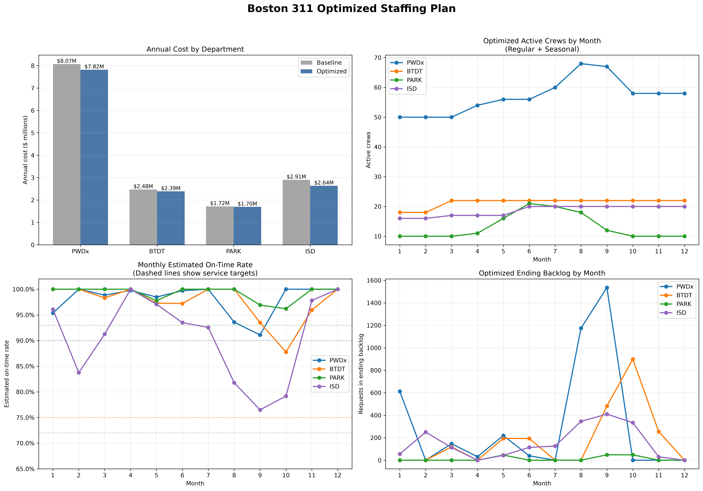
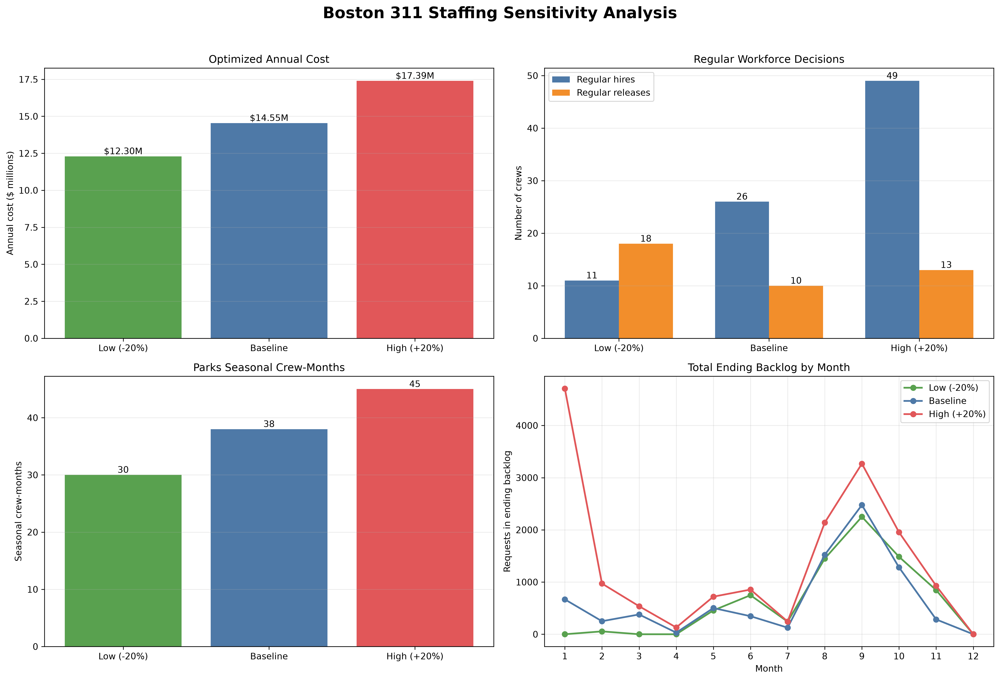

# Boston 311 Demand Forecasting, Staffing Optimization, and GenAI Intake Assistant

This project combines demand forecasting, constrained workforce optimization,
and a retrieval-augmented GenAI assistant to support Boston 311 service
operations. The analysis focuses on four City of Boston departments:

- Public Works (`PWDx`)
- Transportation (`BTDT`)
- Parks and Recreation (`PARK`)
- Inspectional Services (`ISD`)

## Project Components

1. Prepare and analyze Boston 311 request data from 2023 and 2024.
2. Forecast monthly request demand for 2025.
3. Model staffing capacity, cost, backlog, and service performance.
4. Optimize regular and seasonal crews under the staffing constraints in the
   Boston 311 brief.
5. Evaluate low, baseline, and high demand scenarios.
6. Classify resident messages with a GenAI intake assistant using retrieval and
   structured output.

## Key Staffing Results

- Forecasted 2025 requests: **279,343**
- Baseline annual staffing cost: **$15,173,360**
- Optimized annual staffing cost: **$14,545,447**
- Estimated annual savings: **$627,913**
- Cost reduction: **4.14%**
- All departments finish December with zero backlog.
- All department service-level requirements are satisfied.

### Demand Sensitivity

| Scenario | Annual demand | Optimized annual cost |
|---|---:|---:|
| Low (-20%) | 223,476 | $12,297,287 |
| Baseline | 279,343 | $14,545,447 |
| High (+20%) | 335,210 | $17,394,933 |

## GenAI Intake Assistant

The intake assistant retrieves candidate request types from historical Boston
311 records and asks an OpenAI model for a structured classification containing
the request type, department, queue, confidence, and any required follow-up
question.

The submitted 35-message evaluation reports:

- Request-type accuracy: **96.8%**
- Department accuracy: **96.8%**
- Unnecessary follow-up questions on clear messages: **0/31**

See [`genai_assistant/README.md`](genai_assistant/README.md) for setup and usage.

## Dashboards

### Optimized Staffing Plan



### Demand Sensitivity Analysis



## Repository Structure

```text
Boston-311-GenAI-Hackathon/
├── notebooks/
│   └── Boston_311_Forecasting_and_Staffing_Optimization.ipynb
├── genai_assistant/
│   ├── notebooks/
│   │   └── Boston_311_Intake_Assistant.ipynb
│   ├── results/
│   │   └── intake_tests.csv
│   └── README.md
├── data/
│   └── raw/
│       └── README.md
├── outputs/
│   ├── forecast and staffing CSV files
│   └── dashboard images
├── docs/
├── requirements.txt
├── .env.example
├── .gitignore
└── README.md
```

## Local Setup

Clone the repository:

```bash
git clone https://github.com/mihir-parab30/Boston-311-GenAI-Hackathon.git
cd Boston-311-GenAI-Hackathon
```

Create and activate a virtual environment:

```bash
python -m venv .venv
source .venv/bin/activate
```

Install the dependencies:

```bash
python -m pip install -r requirements.txt
```

## Data

The raw 2023 and 2024 Boston 311 CSV files are not committed because each file
exceeds GitHub's normal individual-file size limit. Place these files in
`data/raw/` before running either notebook:

```text
lagan_311_open_data_2023_rvsd3.csv
lagan_311_open_data_2024_rvsd3.csv
```

See [`data/raw/README.md`](data/raw/README.md) for details. Processed forecasts,
optimized staffing plans, sensitivity results, and dashboards are included in
`outputs/`.

## Running the Notebooks

For demand forecasting and staffing optimization, open:

```text
notebooks/Boston_311_Forecasting_and_Staffing_Optimization.ipynb
```

For the GenAI intake assistant, set `OPENAI_API_KEY` in your environment and
open:

```text
genai_assistant/notebooks/Boston_311_Intake_Assistant.ipynb
```

Select the project virtual environment as the kernel and run the cells in
order. Never commit an API key or completed `.env` file.

## Staffing Constraints Modeled

- Department-specific crew productivity and cost
- Initial regular staffing levels
- One-month hiring and training delay
- One-month release notice and release costs
- Parks seasonal staffing from April through October
- Monthly department service-level requirements
- Backlog carryover and overdue-request penalties
- Zero starting backlog and zero year-end backlog
- Low and high demand scenarios at ±20% of baseline

## Project Status

| Component | Status |
|---|---|
| Demand forecasting | Complete |
| Baseline staffing model | Complete |
| Staffing optimization | Complete |
| Demand sensitivity analysis | Complete |
| GenAI intake assistant | Complete; final teammate verification recommended |
| Output CSVs and dashboards | Complete |
| Final report | In progress |
| Architecture diagram | Pending |
| Demo video | Pending |

## Team

- **Mihir Parab** — demand forecasting and staffing optimization
- **Srushti** — GenAI intake assistant

## Responsible Use

The GenAI assistant is a prototype and should not route production requests
without monitoring and human escalation. Historical labels may contain errors
or change over time, and resident messages can include sensitive information.
