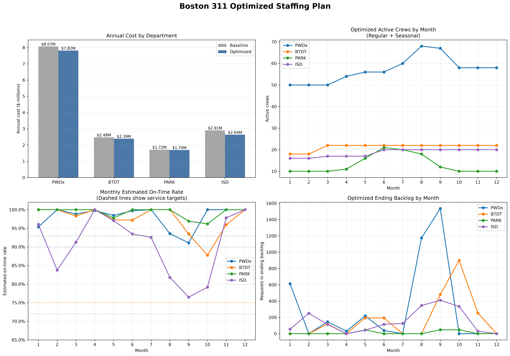
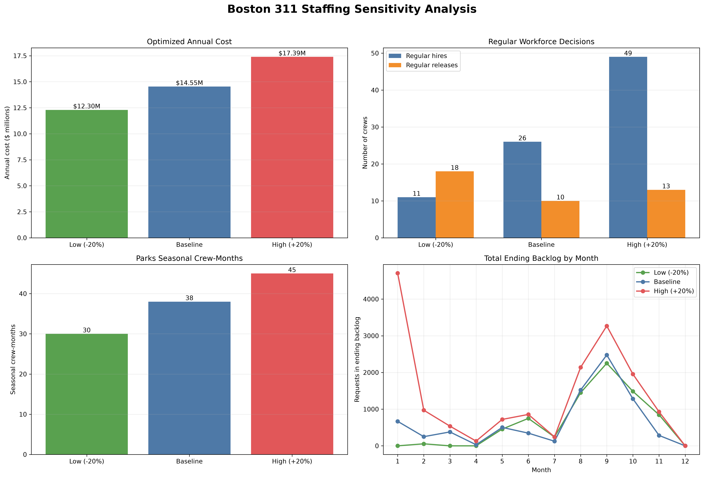
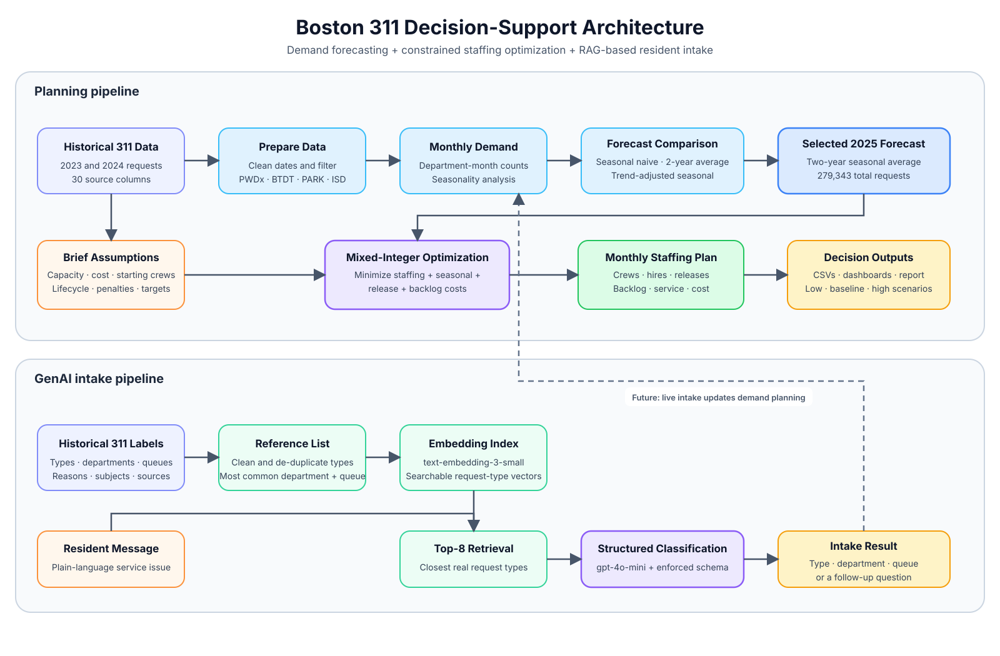

# Boston 311 Demand Forecasting, Staffing Optimization, and GenAI Intake Assistant

**IE 5374 Module 7 Hackathon**  
**Team:** Fatma Koksal, Mihir Parab, and Srishti Rajpurohit

## Executive Summary

Boston 311 receives service requests regarding pothole repairs, missed trash
pickup, parking enforcement, parks maintenance, and building inspections.
Requests volumes are different by department and month, and staffing
decisions are affected by crew productivity, hiring lead time, release lead
time, and other factors. This project unifies three components into one plan:

1. monthly 2025 demand forecast for four Boston departments;
2. a constrained staffing optimization plan; and
3. a retrieval-augmented GenAI intake assistant that classifies residents'
messages.

Based on Boston 311 2023-2024 requests, the demand forecast predicts
**279,343 requests in 2025** for Public Works (`PWDx`), Transportation
(`BTDT`), Parks and Recreation (`PARK`), and Inspectional Services (`ISD`).
A two-year average was chosen to retain department-specific seasonality
without extrapolating a year-over-year trend.

The capacity-focused staffing baseline costs **$15,173,360**. The
optimized plan costs **$14,545,447** — an estimated cost reduction of
**$627,913, or 4.14%**. The optimized plan meets all monthly service
targets and leaves zero backlog in December for all departments. It
eliminates unnecessary permanent staff by coordinating regular hires,
releases, temporary backlog, and Parks seasonal crews.

The GenAI assistant uses retrieval-augmented generation, prompt
engineering, and structured classification. On a test set of 35 resident
messages, it achieved **96.8% request-type accuracy**, **96.8%
department accuracy**, a **96.8% retrieval hit rate at eight candidates**,
and asked for clarification on all four intentionally vague resident
messages.

## 1. Problem and Objectives

The City of Boston needs to choose how many field crews each department
will have in every month of 2025. This plan needs to find the balance
between the operating cost and timely service and comply with the
following operational constraints:

- request demand is different by department and month;
- hiring of a new regular crew takes one month;
- releasing a regular crew requires one month of notice and incurs a
  release cost;
- Parks may hire seasonal crews only in April through October;
- unprocessed requests remain as backlog and incur a penalty; and
- the year-end backlog should be zero.

The project objectives were to forecast monthly demand, formulate a
transparent baseline plan, optimize monthly staffing decisions, test the
plan under uncertain demand, and show how GenAI may be used to improve
the 311 request intake process.

## 2. Data Preparation and Scope

The analysis uses the public 311 service request files of the City of
Boston in 2023 and 2024. These files contain **307,791** and
**306,756** records correspondingly. These two years were merged and
filtered to the four departments specified in the brief. As a result,
there are **558,663 in-scope records**.

The `open_dt` field was transformed to a consistent datetime format, and
each request was assigned the year and the month it was opened. Incoming
requests are counted in the month they were opened, since the staffing
needs to respond to new incoming work. Monthly demand was calculated for
every department.

Exploratory analysis found significantly different seasonal patterns:

- **Public Works:** the demand increases in warmer months and reaches the
  peak around August.
- **Transportation:** the demand is quite stable, with spikes in spring
  and early fall.
- **Parks and Recreation:** the demand is the most seasonal, with a huge
  increase from winter to early summer.
- **Inspectional Services:** the demand is moderately seasonal and higher
  in summer.

These patterns justify monthly department-level planning rather than
annual averages or constant monthly staffing assumption.

## 3. Demand Forecasting

### 3.1 Methods Compared

Three transparent forecasting methods were built:

1. **Seasonal naive:** each 2025 month is equal to the corresponding 2024
  month.
2. **Two-year seasonal average:** each 2025 month is equal to the average
  of the corresponding months in 2023 and 2024.
3. **Trend-adjusted seasonal forecast:** annual growth rate of each
  department from 2023 to 2024 is applied to the 2024 monthly demands.

There were only two historical years available, so a long holdout period
or out-of-sample forecast comparison was not possible. The methods were
compared by their interpretability, ability to preserve seasonality,
and practical plausibility.

### 3.2 Selected Forecast

The **two-year seasonal average** method was chosen as the baseline
method. It retains the observed seasonality while smoothing changes
unique to either of the two historical years. It was better than directly
extrapolating one year's growth or decline into 2025.

| Department | Predicted 2025 requests |
|---|---:|
| PWDx | 164,441 |
| BTDT | 78,383 |
| PARK | 18,143 |
| ISD | 18,376 |
| **Total** | **279,343** |

The output contains 48 department-month forecasts and is saved as
`outputs/boston_311_2025_forecast.csv`.

## 4. Staffing Model

### 4.1 Planning Assumptions

The model uses the assumptions provided in the Boston 311 brief
verbatim.

| Department | Capacity per crew/day | Annual crew cost | January crews | Service target |
|---|---:|---:|---:|---:|
| PWDx | 12 | $130,000 | 50 | 90% |
| BTDT | 15 | $110,000 | 18 | 75% |
| PARK | 6 | $120,000 | 10 | 93% |
| ISD | 4 | $140,000 | 16 | 72% |

The additional assumptions are as follows:

- 21 working days per month;
- one-month lead time to hire and train a regular crew;
- one month of notice before releasing a regular crew;
- 25% annual release charge;
- seasonal crews can be hired by Parks in April through October;
- seasonal crews cost 1.3 times the regular monthly cost of a crew;
- $20 cost for each overdue request;
- $100 penalty for a request that is still open after 30 days; and
- zero backlog at the beginning of January 2025.

### 4.2 Baseline Plan

The baseline is the capacity-focused monthly simulation. It hires crews to
process forecast demand and backlog taking into account the one-month
staffing lead time and seasonal restrictions of Parks crews. It provides
a transparent operational comparison for the optimizer, but tends to
overprovision capacity and almost guarantee 100% on-time service. Its
annual cost is **$15,173,360**.

### 4.3 Optimization Formulation

The staffing problem was formulated as the mixed-integer linear program.
For every department and month, the model decides:

- active regular crews;
- hiring regular crews;
- releasing regular crews;
- hiring Parks seasonal crews;
- ending backlog; and
- backlog older than 30 days.

The objective minimizes annual cost of regular staffing, seasonal
staffing, release charges, overdue request costs, and the additional 30-day
backlog cost. The model enforces staffing balance, monthly capacity,
service targets, nonnegative crew decisions, seasonal availability,
fixed January starting crews, and zero December backlog.

## 5. Optimized Staffing Results

The optimizer found an optimal monthly plan for all four departments and
48 department-month combinations.

| Department | Baseline cost | Optimized cost | Cost savings | Percent reduction |
|---|---:|---:|---:|---:|
| PWDx | $8,072,260 | $7,821,033 | $251,227 | 3.11% |
| BTDT | $2,475,000 | $2,389,487 | $85,513 | 3.46% |
| PARK | $1,720,000 | $1,696,840 | $23,160 | 1.35% |
| ISD | $2,906,100 | $2,638,087 | $268,013 | 9.22% |
| **Total** | **15,173,360**|**14,545,447** | **$627,913** | **4.14%** |

Inspectional Services achieves the largest percent reduction in costs by
hiring four regular crews compared to seven in the baseline. Public Works
achieves the highest dollar savings by keeping the peak number of
regular crews at 68 and releasing 10 crews after the peak. Transportation
reaches the peak at 22 regular crews. Parks keeps 10 regular crews and
uses 38 months of seasonal crews, thereby eliminating unnecessary
permanent capacity in winter.

The optimizer may allow some temporary backlog to be generated where the
additional hiring of a permanent crew would be more costly. This is not
the abandonment of service: the service performance stays at or above the
department service target, the backlog older than 30 days is penalized,
and every department ends up with zero backlog in December.

## 6. Demand Sensitivity Analysis

The full optimization was rerun under demand 20% lower and 20% higher
than the baseline forecast. The seasonal pattern was retained in every
scenario.

| Scenario | Annual demand | Annual cost | Regular hires | Regular releases | Parks seasonal crew-months |
|---|---:|---:|---:|---:|---:|
| Low (-20%) | 223,476 | $12,297,287 | 11 | 18 | 30 |
| Baseline | 279,343 | $14,545,447 | 26 | 10 | 38 |
| High (+20%) | 335,210 | $17,394,933 | 49 | 13 | 45 |

Every scenario ends with zero backlog in December. The high-demand
scenario reveals an important planning issue: the demand in January of
Public Works cannot satisfy the normal 90% target given the fixed
starting number of crews — 50, since there is no possibility to make
the pre-2025 staffing decision. Therefore, the January-only transparent
feasibility target of approximately **79.47%** is imposed in this
scenario, and Public Works returns back to its normal target from
February. This result highlights the importance of contingency hiring,
overtime authority, and/or emergency contractor staffing prior to the
planning year. 

## 7. GenAI Intake Assistant

The GenAI component solves the intake problem from the brief: the resident
describes the issue in ordinary language, and the 311 system requires
valid request type, department, and queue.

### 7.1 Pipeline

1. The real Boston 311 request types, departments, and queues are loaded
   for four departments.
2. HTML codes and whitespace are cleaned, and the reference list is
   deduplicated.
3. Request types with fewer than 20 historical cases are discarded.
4. The reference entries are embedded with `text-embedding-3-small`.
5. The resident message is embedded and the top eight type candidates
   are retrieved.
6. The assistant asks `gpt-4o-mini` to return the structure response
   containing candidate, department, type, queue, confidence, and
   follow-up behavior.
7. Clarifying question is asked instead of guessing where the message
   is vague.

The queue dominance and resident share are kept as useful metrics. 
The Public Works types with distributed geographic district queues are
flagged, since the final queue depends on the resident's location.

### 7.2 Evaluation

The assistant was evaluated on 35 realistic resident messages, 31 of
which are clear and four are intentionally vague.

| Metric | Value |
|---|---:|
| Request-type accuracy | 96.8% |
| Department accuracy | 96.8% |
| Retrieval hit rate at 8 | 96.8% |
| Correct follow-up behavior on vague messages | 100% (4/4) |
| Unnecessary follow-up behavior on clear messages | 0/31 |

The evaluation shows a focused end-to-end prototype but not a production
one. The test set is small, and location-aware routing requires
additional logic.

## 8. System Architecture

The system consists of two connected analytical paths: the planning path
uses historical data for monthly demand forecast and optimization. The
GenAI path uses the historical data for training and testing the
classifier that maps resident messages to 311 labels. Both paths produce
auditable structured outputs.

## 9. Limitations and Responsible Use

### Forecasting and Optimization

- There are only two historical years available, which limits trend
  forecasting and the forecast validation.
- Weather, policy changes, absences, overtime, geography, and travel time
  are not explicitly considered.
- Crew capacities and costs are planning assumptions, not observed
  operational metrics.
- The monthly demand aggregation does not reflect the SLA deadlines
  distribution.
- The example of Public Works January in the high-demand scenario
  demonstrates the need to make a decision prior to the planning horizon.

### GenAI Assistant

- The accuracy is based on a small test set and should be regularly
  monitored with real user messages.
- The most common queue may not always be the correct geographic queue.
- The historical classifications may have inconsistencies or biases.
- The resident messages may contain personal or location information
  and require appropriate privacy controls.
- Uncertain cases should be escalated to humans and not automatically
  routed.

### Equity and Operational Governance

The future evaluations should compare the service levels and backlog by
neighborhood, request source, and resident demographic context where
legally and ethically appropriate. The city-employee-generated requests
may differ from resident-reported requests, so the monitoring should
ensure that the high volume of requests does not slow down low-visibility
neighborhoods.

## 10. Recommendations

1. **Implement monthly workforce planning.** The constant staffing does not
   reflect the significant seasonality of Public Works and Parks demand.
2. **Plan ahead of the peak months.** The hiring decisions must be made
   at least one month before the capacity is needed.
3. **Utilize the Parks seasonal crews properly.** Seasonal staffing is
   cheaper than the unnecessary year-round capacity.
4. **Keep contingency reserve.** Public Works should have pre-year or
   emergency-capacity solution for a high-demand January scenario.
5. **Reforecast monthly.** Substitute forecast months with the real
   demand and re-optimize the remaining planning horizon throughout 2025.
6. **Add location-aware routing.** Expand the GenAI assistant with
   neighborhood or street-to-district mapping for Public Works queues.
7. **Monitor accuracy and equity.** Measure misclassification, escalation,
   response time, and backlog by departments and neighborhoods.

## 11. Team Contributions

- **Fatma Koksal:** historical data preparation, exploratory demand
  analysis, evaluation of forecasting methods, and monthly 2025 demand
  forecasting.
- **Mihir Parab:** staffing capacity model, baseline and optimized
  workforce planning, cost and service optimization, sensitivity analysis,
  validation, and staffing visualization.
- **Srishti Rajpurohit:** Live Agent GenAI intake assistant, including
  retrieval-augmented generation, classification structure, queue
  routing, follow-up logic, and evaluation.

## 12. AI Use Disclosure

Generative AI, including ChatGPT/Codex and Claude, helped in debugging
code, and organizing a notebook for the GenAI assistant.
Team members reviewed the source code, run the models, checked the output files, and
validated the numbers.

## 13. Reproducibility and Deliverables

The GitHub repository contains:

- executed forecasting and staffing notebook;
- executed GenAI intake-assistant notebook;
- dependency and setup instructions;
- forecast, staffing, and sensitivity CSV outputs;
- evaluation results of the GenAI assistant;
- staffing and sensitivity dashboards; and
- the architecture diagram and this report.

The two raw Boston 311 CSV files are excluded due to exceeding the
individual file limit in GitHub. Their required names and placement are
documented in `data/raw/README.md`.

## Conclusion

This project demonstrates how the focus combination of forecasting,
optimization, and GenAI can help with planning and 311 intake. The
optimized staffing plan has cost savings of **$627,913** compared to
the capacity-focused baseline, while meeting the required monthly
service targets and leaving zero backlog at the end of the year. The
GenAI assistant adds the interface for mapping resident requests to
311 routing decisions.
